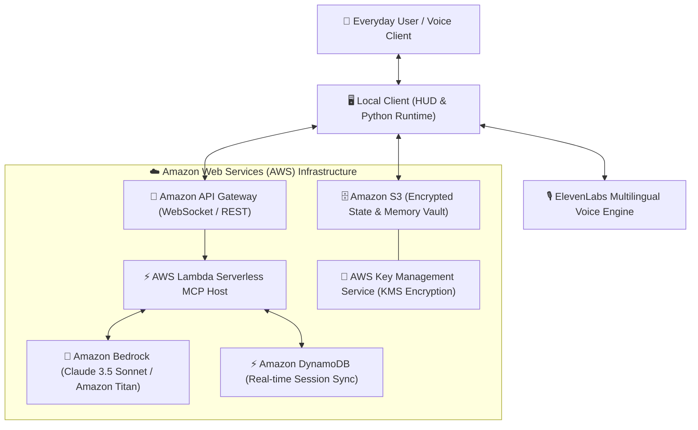

# ☁️ AWS Cloud Architecture Blueprint
### OmniMCP Assistant — Enterprise & Everyday Scalability on AWS

This blueprint documents how the **OmniMCP Virtual Assistant** integrates with Amazon Web Services (AWS) to provide secure, distributed intelligence, real-time tool orchestration, and cross-device state synchronization.

---

## 🏗️ Architectural Topology

---

## 🛠️ Key AWS Services Utilized

### 1. Amazon Bedrock (Foundation Models)
- **Model Choices**: `anthropic.claude-3-5-sonnet-20241022-v2:0` and `amazon.titan-text-express-v1`.
- **Purpose**: High-fidelity semantic reasoning, natural language intent classification, and native MCP tool mapping using the Bedrock Converse API.
- **Advantage**: Zero infrastructure management, enterprise VPC isolation, HIPAA/GDPR compliance, and ultra-low latency inference.

### 2. AWS Lambda (Serverless MCP Hosting)
- **Purpose**: Remote execution of third-party MCP servers (e.g., Slack, Notion, Jira, CRM, Home Automation) without taxing local client CPU/RAM.
- **Scaling**: Scales from 0 to thousands of concurrent requests, meaning zero cost when idle.

### 3. Amazon S3 (State Vault) & AWS KMS
- **Purpose**: Cloud synchronization of user reminders, notes, shopping lists, and long-term memory.
- **Security**: Client-side encrypted payloads stored with server-side AWS KMS (`aws:kms`) keys for end-to-end privacy.

### 4. Amazon DynamoDB
- **Purpose**: Sub-10ms latency session state sharing across multiple devices (desktop HUD, mobile dashboard, tablet).

---

## 🚀 Hack Day 24-Hour Deployment Plan
1. **CDK / Terraform Infrastructure as Code (IaC)**: Deploy Bedrock IAM roles, S3 bucket, and DynamoDB tables in under 5 minutes.
2. **Lambda MCP Hub**: Containerize standard community MCP servers using AWS Lambda container images.
3. **Cognito Authentication**: User login and role-based permissions for shared family or corporate assistants.
