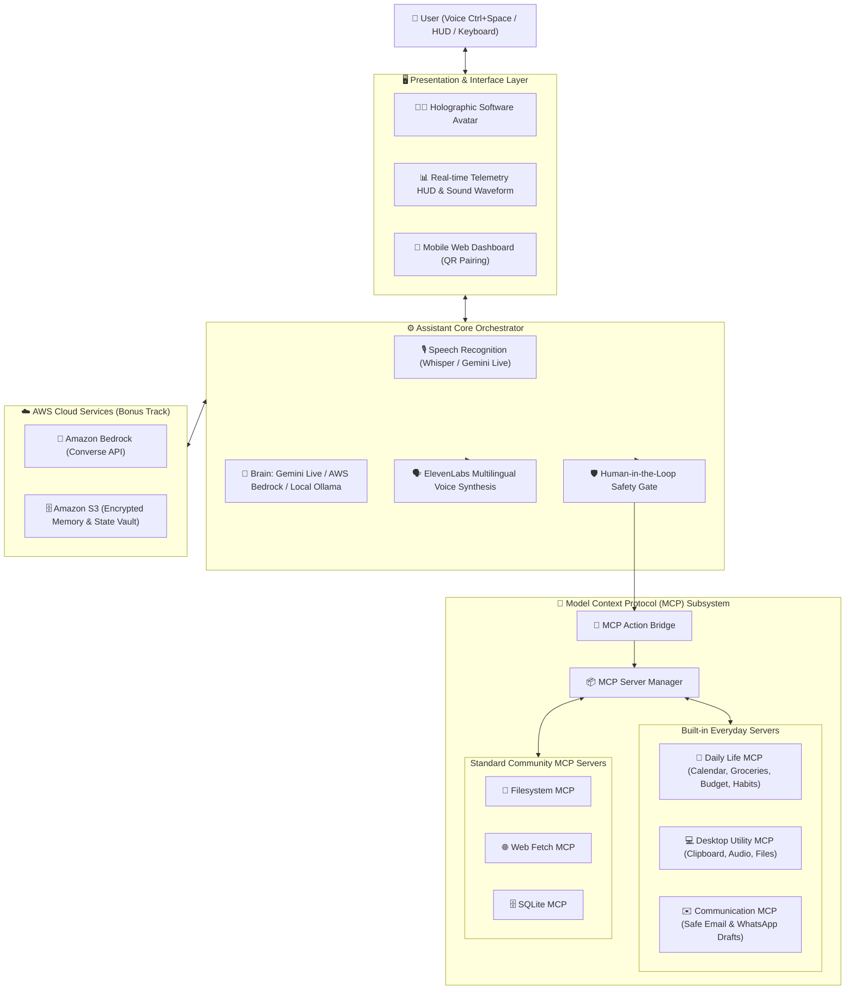

# 🌐 OmniMCP — Everyday AI Virtual Assistant
### *Make MCP Matter — Less Magic, More Utility*

[](#-track-1-challenge-alignment)
[-orange.svg)](https://modelcontextprotocol.io)
[](#-sponsor-technology-integrations)
[-yellow.svg)](#-sponsor-technology-integrations)
[](https://www.python.org/)
[](LICENSE)

---

## 📌 Executive Summary

**OmniMCP** is an open, controlled, everyday virtual assistant powered by Anthropic's **Model Context Protocol (MCP)**, high-fidelity **ElevenLabs real-time voice streaming**, and an **AWS enterprise cloud backbone** (Amazon Bedrock & S3).

While contemporary AI assistants frequently over-promise "magic" with uncontrolled black-box actions that regular people cannot trust or integrate into their daily routines, **OmniMCP focuses on high utility, predictability, and safety**. It bridges everyday applications—shopping lists, local appointments, expense tracking, clipboard intelligence, and communications—under a verified **Human-in-the-Loop Safety Gate**.

---

## 🎯 Track 1 Challenge Alignment: *Less Magic, More Utility*

| Ideathon Requirement | How OmniMCP Solves It |
|---|---|
| **Everyday Utility for Regular People** | Solves practical, day-to-day friction: grocery lists, reminders, daily budget logging, healthy habit tracking, and verified app launching. |
| **Beyond Basic Tool Integrations** | Native **Model Context Protocol (MCP)** client/server runtime. Seamlessly interoperates with local in-process tools and community MCP servers (`filesystem`, `fetch`, `sqlite`, etc.). |
| **Controlled & Reliable Interactions** | **Three-Tier Safety Gate**: Read-only tasks execute instantly; reversible actions provide receipts; critical/external actions (emails, messages, file deletions) pause for explicit user confirmation. |
| **Sponsor Integration: ElevenLabs** | Emotive, ultra-low latency multilingual voice synthesis (`eleven_flash_v2_5`, `eleven_multilingual_v2`) and conversational voice pipeline. |
| **Sponsor Integration: AWS** | Hybrid cloud intelligence powered by **Amazon Bedrock** (Claude 3.5 Sonnet / Amazon Titan) and **Amazon S3** encrypted state synchronization. |

---

## 🏛️ System Architecture



---

## 📦 What's Inside the Codebase

### 1. `mcp/` — Complete Model Context Protocol Engine
- **`mcp/client.py`**: Fully asynchronous MCP client conforming to the 2024-11-05 protocol standard. Supports both stdio subprocess transport and zero-latency in-process Python servers.
- **`mcp/safety_gate.py`**: Enforces "Less Magic, More Utility". Automatically classifies requests into `SAFE`, `REVERSIBLE`, or `CRITICAL`. Never sends unconfirmed emails or deletes files without explicit user consent.
- **`mcp/server_manager.py`**: Aggregates multiple local and external MCP servers into a single discovery and execution registry.
- **`mcp/bridge.py`**: Integrates MCP tools into the assistant's action dispatchers and LLM tool-calling declarations.
- **`mcp/servers/`**: Built-in everyday utility servers:
  - `daily_life_mcp.py`: Shopping lists, daily calendar, expense logging, quick notes, and habit tracking.
  - `desktop_utility_mcp.py`: Clipboard intelligence, safe downloads search, volume management, and window focus.
  - `communication_mcp.py`: Human-in-the-loop email drafting and safe WhatsApp message creation.

### 2. `aws/` — Amazon Web Services Integration
- **`aws/bedrock_client.py`**: Foundation model inference with Amazon Bedrock (Claude 3.5 Sonnet / Titan) with native MCP tool-calling translation.
- **`aws/s3_sync.py`**: Encrypted cloud backup and multi-device synchronization for daily user data.
- **`aws/cloud_architecture.md`**: Complete architectural blueprint for serverless MCP hosting via AWS Lambda & API Gateway.

### 3. `providers/` — Multilingual Voice AI (ElevenLabs)
- **`providers/tts_elevenlabs.py`**: Ultra-low latency voice streaming using ElevenLabs Flash v2.5 and Multilingual models.
- **`providers/elevenlabs_agent.py`**: Conversational voice agent interface for bidirectional streaming audio.

### 4. `actions/` & `core/` — Desktop AI Assistant Runtime
- Holographic software avatar (no GPU required).
- Push-to-Talk (`Ctrl+Space`) and local "Hey Jarvis" wake-word detection.
- Persistent local memory and undo ledger for file modifications.

---

## ⚡ Quickstart Guide

### Prerequisites
- Python 3.10 to 3.12 recommended (compatible with 3.10+)
- Windows, macOS, or Linux

### 1. Clone & Setup Environment
```bash
git clone https://github.com/tejas448866/AI-Virtual-Assistant-MCP.git
cd AI-Virtual-Assistant-MCP
python -m venv .venv
source .venv/bin/activate  # On Windows: .venv\Scripts\activate
pip install -r requirements.txt
```

### 2. Run the Test Suite
Verify that all MCP servers, protocol clients, and safety gates are operating:
```bash
python -m unittest discover tests
```

### 3. Launch the Virtual Assistant
```bash
python main.py
```
*Note: On first launch, the setup wizard will guide you to configure your preferred speech engine (Gemini Live, ElevenLabs Voice, or local Whisper/Piper).*

---

## 💡 Everyday Utility Walkthroughs

### 🛒 1. Grocery & Shopping Management
- **User says**: *"Add oat milk, eggs, and whole wheat bread to my grocery list."*
- **MCP Action**: `mcp_daily_grocery_list(action="add", items="oat milk, eggs, whole wheat bread")`
- **Output**: *"Added 3 items to your grocery list. Would you like me to read your pending items?"*

### 💰 2. Daily Budget Logging
- **User says**: *"Log 15 dollars on lunch at Subway."*
- **MCP Action**: `mcp_daily_budget_tracker(action="log", amount=15.0, category="Food", note="lunch at Subway")`
- **Output**: *"Logged $15.00 under Food. Your total food expenditure for this week is $64.50."*

### ✉️ 3. Safe Communication Draft (Safety Gate in Action)
- **User says**: *"Send an email to my manager asking for Friday afternoon off."*
- **Safety Gate**: Pauses direct external sending. Enforces draft generation first.
- **MCP Action**: `mcp_comm_draft_email(recipient_name="Manager", subject="Time Off Request - Friday Afternoon", ...)`
- **Output**: Displays the formatted draft in the HUD:
  > *"Dear Manager, I would like to request time off this Friday afternoon... Shall I copy this to your clipboard or send it?"*

---

## 🏆 Ideathon Deliverables Checklist

- [x] **Public GitHub Repository**: Complete, clean, documented MVP code.
- [x] **Track 1 Challenge Focus**: Model Context Protocol (MCP) for everyday utility ("Less Magic, More Utility").
- [x] **Sponsor Integration 1**: ElevenLabs Voice AI integration.
- [x] **Sponsor Integration 2**: AWS Bedrock and Amazon S3 cloud synchronization.
- [x] **Submission Guide & Pitch Blueprint**: Included in [`SUBMISSION_GUIDE.md`](SUBMISSION_GUIDE.md).

---

## 📄 License
This project is licensed under the MIT License — see the [LICENSE](LICENSE) file for details.
